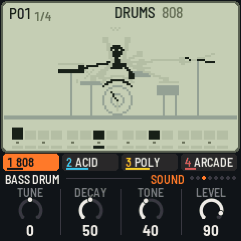
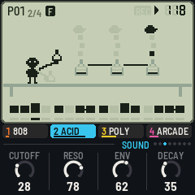
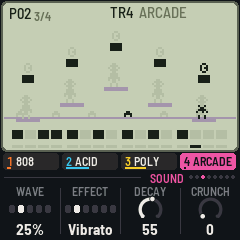

# LCD-4 for the M-VAVE FM-1

[](https://github.com/devrvega/LCD-4/actions/workflows/build.yml)
[](https://github.com/devrvega/LCD-4/releases/latest)
[](LICENSE)

LCD-4 turns the M-VAVE FM-1 into a four-track pocket groovebox: a drum machine and three synths in 16-step
patterns you chain together, with chords the synths follow and sixteen punch-in effects, after the little
synths that live in a calculator's body. Each sound has its own little LCD game on the screen, in the manner
of the old handheld games, and it moves with the music.



| | |
|---|---|
| **[Try it in the browser](https://devrvega.github.io/LCD-4/emu/)** | The same code the FM-1 runs, with sound. No FM-1 needed. |
| **[Install it](https://devrvega.github.io/LCD-4/install/)** | From Chrome or Edge, with the FM-1 on USB. Nothing to install on the computer. |
| **[Read the manual](docs/MANUAL.md)** | Getting started in ten steps, then every control, sound and page. |
| **[Download](https://github.com/devrvega/LCD-4/releases/latest)** | The firmware file (`lcd4-X.Y.Z.fwsc`) of every release, and its source. |

## What's in it

- **Drums (track 1):** four kits of eleven parts: an 808, a 909, an arcade console's (pulse kicks, noise
  snares, blips, zaps, a coin) and a rhythm box (a CR-78 and a 606). The black keys pick the part and play it;
  the white keys are its 16 steps, as on X0X.
- **Synths (tracks 2–4):** sixteen sounds, each modelled on its original's circuit, no samples:

  | Basses | Keys | Leads |
  |---|---|---|
  | Acid (TB-303), Mono (SH-101), Fat (Minimoog), Boom (808 sub), FM bass (DX7), Reese | Poly (Juno-60), Brass (Prophet-5 / OB-Xa), E.Piano (DX7), Organ (M1), Strings (Solina), Bells (DX / PPG) | Sync, Scream (MS-20), Arcade (NES / Game Boy), Arp (chip arpeggios) |

- **The way a pocket operator works:** sixteen patterns and chains of up to 64; writing live or step by step;
  a step held for its note, length and two locked knobs; slides, ratchets, accents and swing; sixteen effects
  held or written onto the steps; chords and chains of chords that the synth tracks follow.
- **Four demo songs** (Pocket, Arcade, House, Lo-fi), MIDI in and out, MIDI clock.

  

## In short

| | |
|---|---|
| ALGORITHM · PRESETS | The track (1 drums, 2–4 synths) · its sound or kit |
| Keys | Drums: black keys the parts, white keys their steps · synths: a keyboard |
| PLAY · REC | Play / stop · write (live while playing, step by step stopped) |
| HOME · SEQ · LFO · ENV · ARP · SEL · FX · GLO | The pages: Patterns, Steps, Sound, Track, Chords, Mixer, FX, Setup |
| HOME / ARP / FX held | The white keys are patterns, chords, effects (pressed in order: a chain) |
| A step held + knobs | Its note, length, locks; OCT− a slide, OCT+ a ratchet |
| ENV · EDIT held + a key | An accent · cleared |
| OCT− · OCT+ | The keyboard's octave (drums: the part) |
| SAVE | Saves (and by itself, stopped); held + a pattern: a copy |

Hold any button for a second and a card says what it does.

## Installing, and going back

- **From the browser:** the [web installer](https://devrvega.github.io/LCD-4/install/) (Chrome or Edge, a USB
  data cable).
- **From the command line:** download `lcd4-X.Y.Z.fwsc` from the
  [latest release](https://github.com/devrvega/LCD-4/releases/latest), then
  `pip3 install mido python-rtmidi` and `python3 tools/fm1_install.py lcd4-X.Y.Z.fwsc`.
- **Going back:** the installer's "Back to the stock firmware" puts M-VAVE's firmware back, as does M-VAVE's
  own updater, M-UPGRADE. Any other FM-1 firmware installs over LCD-4 as it would over the stock one.
- **Your saved work:** LCD-4 keeps its settings where several other FM-1 firmwares keep theirs (IND-1, AMB-1,
  X0X and others built on Felucca). Installing it starts it with the first demo song, and its first save
  replaces what one of those had saved there.

Installing other firmware is at your own risk, though it's hard to get stuck: an FM-1 that fails to start
twice comes up in a safe mode the installer can reach, and the manual's
[Troubleshooting](docs/MANUAL.md#15-troubleshooting) covers the rest.

## Status

LCD-4 is young (0.x). It has been built, installed and run on an FM-1, and measured there: the first demo
song takes about a quarter of the FM-1's time, and the heaviest thing it can be asked to do (three tracks of
four-note chords with every drum on every step) stays under four fifths, with a governor that thins the chords
if it ever gets closer. How the sounds and the scenes come across on the FM-1's own speaker and screen is
where feedback helps most.

## Ideas and problems

- **Something you'd like:** a [feature request](https://github.com/devrvega/LCD-4/issues/new?template=feature_request.yml).
- **Something wrong:** a [bug report](https://github.com/devrvega/LCD-4/issues/new?template=bug_report.yml)
  (the version is at the bottom left of the Setup page).

## Make it your own

Fork it, change it, release your own: [CONTRIBUTING.md](CONTRIBUTING.md) says where things are, how to give
your version its own name and identity, and how to send changes back. Every push is built and tested on
GitHub; a tag `vX.Y.Z` makes a release, and the site (emulator, installer, manual) follows it.

```
tests/run_tests.sh                               # the tests, the app in a simulator
./build.sh                                       # build/lcd4.fwsc (see BUILDING.md)
python3 tools/fm1_install.py build/lcd4.fwsc     # install it over USB
```

## Credits

LCD-4 is built on IND-1, itself built on [AMB-1](https://github.com/charlesvestal/fm1-amb) by Charles Vestal:
the engine's frame, screen, simulator and emulator. The reverb is Jon Dattorro's plate ("Effect Design, Part
1", JAES 1997), by way of FoMni-1 and AMB-1. The platform (hardware layer, USB, update loader, storage,
installer) is [Felucca](https://github.com/hugelton/Felucca)'s by Leo Kuroshita (Hügelton Instruments), by way
of [X0X](https://github.com/charlesvestal/fm1-x0x), FoMni, AMB-1 and IND-1; X0X showed how the black keys pick
the drums. The idea of running FM-1 firmware in the browser comes from [Groove OS](https://www.groove-os.com/).
GPL-3.0-only; see [LICENSING.md](LICENSING.md).

M-VAVE and FM-1 are trademarks of their owners, as are the instruments' names. LCD-4 is not affiliated
with M-VAVE, Teenage Engineering, Nintendo, the instruments' makers, Charles Vestal or Hügelton
Instruments; its sounds, scenes and characters are its own.
