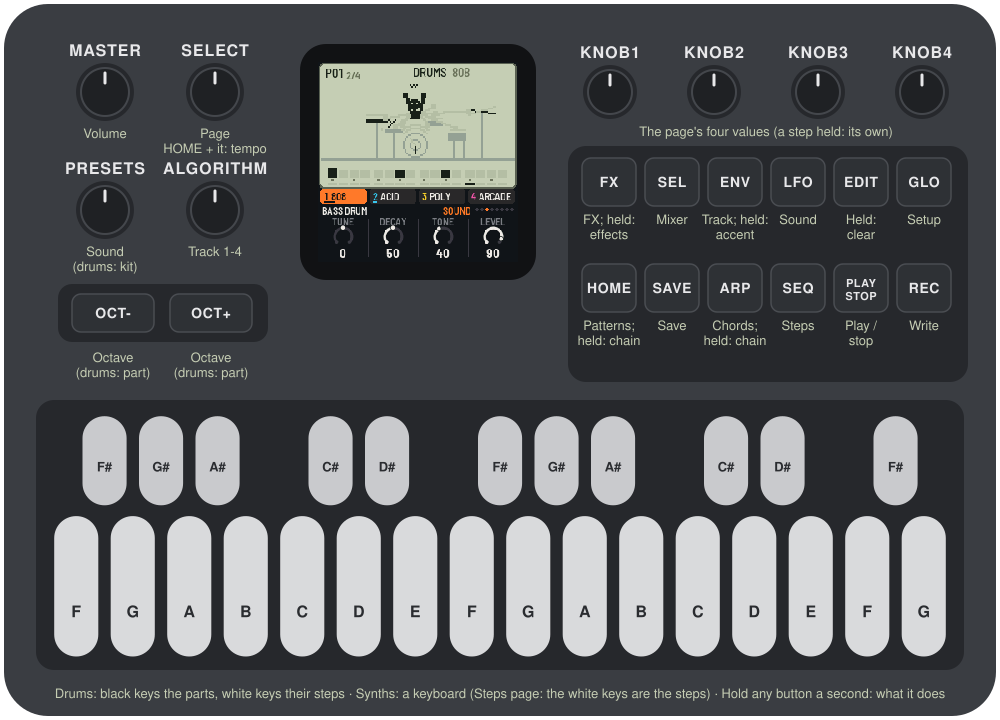
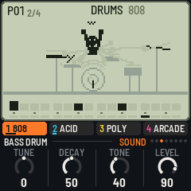
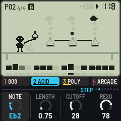
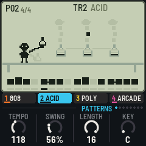
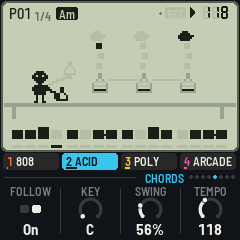
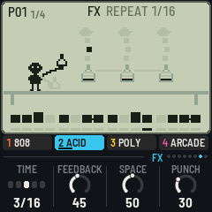

# LCD-4

LCD-4 turns the M-VAVE FM-1 into a four-track pocket groovebox: a drum machine with four kits and three
synth tracks with sixteen sounds, each modelled on a classic's circuit. You write 16-step patterns, chain
them, give the synths chords to follow, and play punch-in effects over the top. On the screen, every sound
has its own little LCD game, in the manner of the old handheld games and the pocket synths that took after
them, and it moves with the music.



---

## Contents

1. Install
2. Getting started
3. Controls
4. The screen
5. The tracks
6. The drums
7. The synth sounds
8. Writing
9. Patterns and chains
10. Chords
11. Effects
12. The pages
13. MIDI
14. Saving
15. Troubleshooting
16. Credits

---

## 1. Install

**Try it first:** [the browser emulator](https://devrvega.github.io/LCD-4/emu/) runs the same code with
sound, played with the mouse, a touch screen or the keyboard.

**Install from the browser:** open [the web installer](https://devrvega.github.io/LCD-4/install/) in
Chrome or Edge, connect the FM-1 with a USB data cable and press Install. Don't unplug it while it's
writing; when it finishes, the FM-1 restarts into LCD-4.

**Install from the command line:** download `lcd4-X.Y.Z.fwsc` from the
[latest release](https://github.com/devrvega/LCD-4/releases/latest), install Python 3 with
`pip3 install mido python-rtmidi`, and from the LCD-4 source run:

```
python3 tools/fm1_install.py lcd4-X.Y.Z.fwsc
```

**Which version:** the Setup page (GLO) shows it at the bottom left, and the start screen under the name.

**Go back:** "Back to the stock firmware", at the bottom of the installer page, puts M-VAVE's firmware
back (download the FM-1 V15 file from the link there, choose it, press the button). M-VAVE's own
updater, M-UPGRADE, works too.

> Installing other firmware is at your own risk. If the FM-1 ever won't start, see
> [Recovering an FM-1 that won't start](#recovering-an-fm-1-that-won-t-start).

**Coming from IND-1 or AMB-1:** LCD-4 keeps its settings where they kept theirs, under another name, and
its patterns in a place of their own. None of them reads the others': installing LCD-4 starts it with the
first demo song, and LCD-4's first save replaces what the other firmware had saved.

---

## 2. Getting started

1. Switch the FM-1 on and turn **MASTER** up. LCD-4 starts with a demo song in its patterns, stopped.
2. Press **PLAY**. Four tracks play: an 808, a 303-style bass, Juno chords and a chip lead, over a chain of
   patterns and a chain of chords.
3. Turn **ALGORITHM** to pick a track. The tabs under the screen show the four tracks and what each plays;
   the scene on the screen changes with the track's sound.
4. Turn **PRESETS** to give the track another sound (on track 1, another kit). Try them all: each has a
   scene of its own.
5. On a synth track, play the keys. **OCT−** and **OCT+** move them an octave.
6. Turn ALGORITHM to track 1, the drums. A **black key** picks a part (and plays it); the **white keys**
   are that part's 16 steps: press one to switch it on or off.
7. Press **REC** (writing) while it plays, and play: on a synth track, the notes go into the pattern; on
   the drums, the black keys do. Press REC again to stop writing.
8. Press **HOME** for the patterns: a white key picks the next pattern. Hold one key and press others for
   a chain.
9. Hold **FX** and press a white key: an effect, for as long as you hold it.
10. Hold any button for a second and a card says what it does. Your work saves itself a few seconds after
    you stop; **SAVE** saves at once.

---

## 3. Controls

| Control | What it does |
|---|---|
| **ALGORITHM** | The track: 1 the drums, 2, 3, 4 the synths |
| **PRESETS** | The track's sound (on the drums, the kit) |
| **SELECT** | The previous or next page; with HOME held, the tempo |
| **KNOB 1–4** | The page's four values; with a step held, the step's own |
| **MASTER** | Volume |
| **PLAY** | Play / stop |
| **REC** | Writing on / off (PLAY turns red) |
| **EDIT** | Held: a key, a step, a pattern or a row cleared. With REC: the track in this pattern cleared |
| **ENV** | The Track page. Held: a key or a step gets an accent |
| **OCT− / OCT+** | The keyboard's octave. On the drums: the part before, the next part. A step held: a slide, a ratchet |
| **HOME** | The Patterns page. Held: the white keys are patterns, pressed in order a chain |
| **ARP** | The Chords page. Held: the white keys are chords, pressed in order a chain |
| **FX** | The FX page. Held: the white keys are effects, while you hold them |
| **SEQ · LFO · SEL · GLO** | The Steps, Sound, Mixer and Setup pages |
| **SAVE** | Saves. Held with a white key on the Patterns page: this pattern copied there. Held on Setup: a demo song |
| **The keys** | Drums: the black keys are the parts, the white keys their steps. Synths: a keyboard (on the Steps page, the white keys are the steps) |

A page's button pressed again goes back to the Sound page. **Hold OCT− and OCT+ together for five
seconds** for the update mode (see Troubleshooting).

---

## 4. The screen



The top of the screen is an LCD, as on a handheld game:

- **The status line:** the pattern playing (P01), its place in the chain (1/4), the chord (on a dark
  tag); then REC, play or stop, and the tempo in segments. A small dot means changes not saved yet. A
  message takes the middle for a moment when you change something.
- **The scene:** a little game for the track's sound. Its parts are LCD segments: dark when lit, and
  faintly there when not, so you can see every pose a character can take. The music lights them.
- **The steps:** the track's 16 steps. A filled cell has a note (on the drums, the part plays); a tall
  one is accented; lines across it are a ratchet; a tail joins a slide to the next step; a dot above is a
  locked knob, a mark at its top-left an effect written there. The bar under it is the playhead. Small
  dots under the drums' steps show where the other parts play. Steps past the pattern's length are dashes.

Below the LCD:

- **The tracks:** four tabs, the selected one lit in its colour, with each track's sound and a meter. A
  muted track is struck through.
- **The knobs:** the page's name and its place among the pages (the dots), the four knobs' names, rings
  and values. A knob just turned is lit. On the drums, the part the knobs are for is at the left.



---

## 5. The tracks

Track 1 is the drums; tracks 2, 3 and 4 are synths. Any synth track can load any of the sixteen sounds;
the drum track loads any of the four kits. Each track remembers its knobs for every sound, so you can try
another sound and come back. Each track has a colour: orange, cyan, yellow and pink.

The **Track page** (ENV) sets the track's Level, Pan, and how much it sends to the Delay and the Reverb.
The **Mixer** (SEL) has the four levels together, and mutes.

---

## 6. The drums

The **black keys** pick the part (and play it). The **white keys** are the part's 16 steps: press a step
and let go to switch it on or off. The Sound page's knobs are the part's own: **Tune** (an octave up or
down), **Decay** (a quarter to four times as long), **Tone** (what it means depends on the part: the
kick's click, the snare's snap, the hats' brightness) and **Level**.

- **ENV + a white key:** an accent on that step (all the drums on it play harder).
- **EDIT + a white key:** the step cleared (every part on it); **EDIT + a black key:** the part's whole
  row cleared.
- **OCT− / OCT+:** the part before, the next part.
- **Hold a step and turn KNOB 1 or 2:** that step's tune or decay, moved for every part on it.

Every kit has the same eleven places, so a pattern written on one kit makes sense on another:

| Black key | 808 | 909 | Arcade | Box |
|---|---|---|---|---|
| 1 (F#) | Bass drum | Bass drum | Kick | Bass drum |
| 2 (G#) | Snare | Snare | Snare | Snare |
| 3 (A#) | Low tom | Low tom | Low tom | Low tom |
| 4 (C#) | Mid tom | Mid tom | Mid tom | High tom |
| 5 (D#) | High tom | High tom | High tom | Conga |
| 6 (F#) | Rim shot | Rim shot | Blip | Claves |
| 7 (G#) | Clap | Clap | Zap | Guiro |
| 8 (A#) | Closed hat | Closed hat | Hat | Closed hat |
| 9 (C#) | Open hat | Open hat | Open hat | Open hat |
| 10 (D#) | Cymbal | Crash | Crash | Tambourine |
| 11 (F#) | Cowbell | Ride | Coin | Cowbell |

The closed hat cuts the open hat off, as on the machines.

- **808:** a sine that rings and dies for the kick and toms (its bridged-T resonators), two heads and
  snappy noise for the snare, a clap of noise bursts, the cymbal and hats from six square oscillators
  through band-passes (the 808's own frequencies), the cowbell's two squares.
- **909:** a kick swept down from a click, triangles and noise for the snare, swept toms, hats and
  cymbals of metal and noise (the real ones were 6-bit samples).
- **Arcade:** a games console's sound chip: pulse and triangle waves swept in pitch, its 15-bit noise
  register (long, or short and metallic), volume in sixteen steps; a blip, a laser zap and a coin.
- **Box:** a CR-78 and a TR-606: a soft kick, a snare, toms, a conga, claves, a guiro's scrape, metallic
  hats, a tambourine and a cowbell.

On screen, Pip plays the 808, a press shop stamps to the 909, invaders march to the arcade kit and Pip
plays the congas on a beach to the box.

---

## 7. The synth sounds

Each sound has four knobs on the Sound page (LFO). **A and B** (the first two) can be locked on a step.
Mono sounds glide where notes overlap; the keys (Poly to Bells) play four notes at once.

| Sound | Modelled on | Knobs (A, B, C, D) | On screen |
|---|---|---|---|
| **Acid** | Roland TB-303 | Cutoff, Reso, Env, Decay | A lab: bubbles climb out of the flasks; an accent boils one over |
| **Mono** | Roland SH-101 | Cutoff, Reso, Sub, Decay | Pip with a keytar on stage; an accent is a jump |
| **Fat** | Minimoog Model D | Cutoff, Emphasis, Contour, Decay | A strongman: the bar goes up with the notes |
| **Boom** | an 808's sub bass | Punch, Drive, Decay, Glide | A submarine's sonar pings |
| **FM bass** | Yamaha DX7 | Bright, Grit, Decay, Sub | A pinball table: flippers, bumpers, the score |
| **Reese** | detuned saws | Cutoff, Detune, Motion, Drive | A night drive: the car takes the note's lane |
| **Poly** | Roland Juno-60 | Cutoff, Chorus, Attack, Release | A sunset over a grid; the rays are the voices |
| **Brass** | Prophet-5 / OB-Xa | Cutoff, Env, Attack, Detune | Pip with a trumpet |
| **E.Piano** | DX7 E.Piano 1 | Tine, Bark, Decay, Tremolo | Pip at the piano; the lamp glows with the tremolo |
| **Organ** | Korg M1's house organ | Tone, Perc, Chorus, Release | A carousel |
| **Strings** | ARP Solina | Bright, Ensemble, Attack, Release | Pip conducting a string section |
| **Bells** | DX / PPG bells | Tone, Metal, Decay, Shimmer | A bell tower: the note picks the bell |
| **Sync** | a hard-sync lead | Sync, Sweep, Cutoff, Glide | A rocket at the note's height |
| **Scream** | Korg MS-20 | Cutoff, Peak, Drive, Highpass | A monster roars at the city |
| **Arcade** | NES and Game Boy channels | Wave, Effect, Decay, Crunch | A platform game: a jump and a coin a note |
| **Arp** | chip arpeggios | Mode, Rate, Decay, Tone | Pip climbs the stairs, one a note |

Some of them, closer:

- **Acid:** a saw through a resonant low-pass with the 303's high-pass in its feedback, its envelope
  short or long (Decay), and its accent: louder, a shorter, brighter sweep, and the "wow" that builds when
  accents follow each other. A slide (see Writing) glides into the next note without starting the
  envelopes again.
- **Poly:** the Juno's one oscillator (a saw and a pulse whose width moves), its 24 dB filter moved by the
  same envelope as the amp, and its BBD chorus: Chorus off, I, II, or both.
- **Strings:** a divide-down saw and its octave, mellowed, through the Solina's ensemble: three delays
  wobbling at two rates, 120 degrees apart.
- **E.Piano:** two FM pairs, as the DX7's: the body (Bark, dying over a second) and the tine (ratio 14,
  gone in 50 ms); Tremolo is a suitcase's stereo pan.
- **Arcade:** **Wave** picks the console's channel: a pulse of 12.5, 25 or 50 %, the 32-step triangle, or
  noise (its pitch the note). **Effect** is what a tracker would do to it: vibrato, portamento, an
  arpeggio (the chord's), a blip (down from an octave), a rise. **Decay** at its top holds the note.
  **Crunch** is a slower, coarser converter.
- **Arp:** each note of a step runs as an arpeggio for as long as the step lasts. A chord on the step runs
  over its notes; a single note runs over the chord playing (see Chords), or its triad. **Mode:** up,
  melodic (leapfrogging), down, octaves. **Rate:** sixteenths, triplets, 32nds, 48ths.

---

## 8. Writing

**On the steps** (any time, playing or not): on the drums, the white keys always are the part's steps.
On a synth track, the **Steps page** (SEQ) turns the white keys into its 16 steps.

- Press an empty step: it takes **the notes in hand**, what you last played on the keys (a chord, if you
  played one), one step long. Stopped, you hear it.
- Press a full step: it's cleared.
- **Hold a step and turn the knobs:** KNOB 1 its note (a chord moves together), KNOB 2 its length
  (in quarter steps, up to 16 steps: a long note holds over the next steps), KNOB 3 and 4 the sound's A and
  B for that step alone (a lock). Turning a held empty step fills it first.
- **Hold a step and press OCT−:** a slide into the next note (the 303's: on a mono sound the pitch glides
  and the envelopes go on). **OCT+:** a ratchet, the note played two, three or four times in its step.
- **ENV + a step:** an accent. **EDIT + a step:** cleared.

**Live** (REC on, playing): what you play goes into the pattern playing, on the nearest step.

- Synth tracks: each key's note and how long you hold it; keys pressed together make a chord on one step;
  a key pressed while another is still held makes the first slide into it. Hold ENV for accents.
- The drums: the black keys, on their steps (hold ENV for accents). A hit just before a step doesn't play
  twice.
- On a synth track, turning KNOB 1 or 2 on the Sound page writes their values as locks on the steps as
  they pass.
- An effect held (FX) is written onto the steps it plays over.

**Step by step** (REC on, stopped, a synth track on the Sound page): each key (or chord) goes on the next
step, from the first; **EDIT** is a rest. The cell waiting for a note blinks.

**Clearing:** EDIT + REC clears the selected track in this pattern.

---

## 9. Patterns and chains



A pattern holds all four tracks: the drums' steps and accents, the three synth tracks' steps, the effects
written on its steps, and its length. There are sixteen, on the white keys of the **Patterns page**
(HOME), or with HOME held from any page.

- **A key:** that pattern next. While playing, it starts when this one ends; stopped, at once. The pattern
  playing is the one you edit.
- **Hold a key and press others, or hold HOME and press keys in order:** a chain, up to 64 long, repeats
  allowed (1, 1, 1, 4 plays pattern 1 three times, then 4). It starts over when this pattern ends.
- **SAVE + a key:** this pattern copied there. **EDIT + a key:** that pattern cleared.
- The keys' lights show the chain; the one playing blinks.

The page's knobs: **Tempo** (40–240), **Swing** (50 % straight to 75 %, the off-beats later), **Length**
(this pattern's steps, 1–16) and **Key** (everything the synths play, moved to it; see Chords).

---

## 10. Chords



The **Chords page** (ARP) puts sixteen chords on the white keys, in C (Key moves them):

| Key | 1 | 2 | 3 | 4 | 5 | 6 | 7 | 8 | 9 | 10 | 11 | 12 | 13 | 14 | 15 | 16 |
|---|---|---|---|---|---|---|---|---|---|---|---|---|---|---|---|---|
| Chord | C | Dm | Em | F | G | Am | Bb | E | Cmaj7 | Dm7 | Em7 | Fmaj7 | G7 | Am7 | Fm | Gsus4 |

- **A key:** that chord, held. **Hold a key and press others, or hold ARP and press keys:** a chain of up
  to 64, a chord each time a pattern starts (so a four-chord chain over a one-pattern loop goes round every
  four bars). **EDIT + a key:** no chords.
- **Follow** (KNOB 1, for the selected track): the track's notes follow the chord. Write the parts in C;
  each note moves with the chord's root (no more than half an octave), and the scale bends to the chord:
  in a minor chord E is played as Eb, A as Ab and B as Bb; a seventh chord flattens B; a suspended chord
  raises E to F. A bass line, a riff and a pad written once then play the whole progression.
- The Arp sound plays the chord's notes; the Arcade's arpeggio takes its major or minor.

With no chords, the notes play as written (and Key still moves them).

---

## 11. Effects



Hold **FX** and press a white key (or use the keys on the FX page): the effect lasts as long as you hold
the key. While writing, it's written onto the steps it plays over, and plays there every time.
**EDIT + an effect's key** takes it off the pattern's steps.

| Key | Effect | |
|---|---|---|
| 1 | Repeat 1/16 | The step playing when you pressed, over and over |
| 2 | Repeat 1/8 | Two steps, over and over |
| 3 | Repeat 1/4 | A beat, over and over |
| 4 | Stutter | The step repeated in 32nds |
| 5 | Reverse | The steps backwards |
| 6 | Half speed | Each step played for two |
| 7 | Glitch | Steps at random, some doubled |
| 8 | Fill | The drums: a snare roll, the toms down |
| 9 | Octave up | The synths an octave up |
| 10 | Octave down | The synths an octave down |
| 11 | Solo drums | The synths out |
| 12 | Solo synths | The drums out |
| 13 | Low-pass | A filter sweeping down over two bars |
| 14 | High-pass | A filter sweeping up over two bars |
| 15 | Crush | A quarter of the rate, six bits |
| 16 | Echo | Everything into the delay, its feedback up |

The **FX page**'s knobs: **Time** (the delay's, in sixteenths: 1/16, 1/8, 3/16, 1/4, 3/8), **Feedback**,
**Space** (how long the plate rings) and **Punch** (a bus compressor: more of it, louder and tighter).

---

## 12. The pages

| Page | Button | Knobs | The white keys |
|---|---|---|---|
| Patterns | HOME | Tempo, Swing, Length, Key | Patterns, chains |
| Steps | SEQ | The sound's (a step held: Note, Length, A, B) | Steps |
| Sound | LFO | The sound's (drums: the part's Tune, Decay, Tone, Level) | Synths: notes; drums: steps |
| Track | ENV | Level, Pan, Delay, Reverb | As the Sound page |
| Chords | ARP | Follow, Key, Swing, Tempo | Chords, chains |
| Mixer | SEL | The four tracks' levels | 1–4 mute the tracks, 5–8 pick one |
| FX | FX | Time, Feedback, Space, Punch | Effects |
| Setup | GLO | Tune, MIDI out, Clock, Demo | As the Sound page |

**Setup:**

- **Tune:** ±50 cents.
- **MIDI out:** off or on (see MIDI).
- **Clock:** Auto follows MIDI clock when it comes; Internal ignores it.
- **Demo:** pick one of four demo songs (Pocket, Arcade, House, Lo-fi), then **hold SAVE** for a moment
  to load it. It replaces every pattern and setting, and is saved like any change (by itself a few seconds
  after, while stopped): save anything you want to keep before you load one.
- The status line shows how much of the FM-1's time the sound takes (CPU).

---

## 13. MIDI

MIDI comes in over USB and the TRS jack, and goes out over USB.

- **In, notes:** channel 1 (or 10) plays the drums (General MIDI: kick 36, snare 38, toms 41, 45 and 48,
  rim 37, clap 39, closed hat 42, open hat 46, cymbal 49, cowbell 56); channels 2, 3 and 4 play tracks 2,
  3 and 4. While writing and playing, they're written like the keys.
- **In, clock** (Clock: Auto): the steps follow MIDI clock, start and stop start and stop LCD-4 (start:
  from the chain's top). The status line shows EXT for the tempo.
- **Out** (MIDI out on): the drums on channel 10 (the notes above), tracks 2–4 on channels 2–4 with their
  lengths; and clock with start and stop when LCD-4 runs on its own tempo.

---

## 14. Saving

LCD-4 keeps everything in the FM-1's memory: the sixteen patterns, the chains, the chords, every track's
sound and knobs (for every sound), the kits' parts, and the setup.

- **By itself:** a few seconds after a change, but only while stopped. Writing to the memory interrupts
  the sound for a moment, so it never happens while it plays. A dot in the status line means there are
  unsaved changes.
- **SAVE:** saves now, playing or not.

---

## 15. Troubleshooting

**Update mode:** hold OCT− and OCT+ together for five seconds. A countdown appears; let go before it
ends to cancel.

**Calibration:** if a button or knob does the wrong thing, hold OCT− and OCT+ while you switch the FM-1
on. The screen then asks you to press each button and turn each knob in turn.

**Clicks or dropouts:** the most the FM-1 has to do is three tracks of four-note chords with every drum
on every step; even then it keeps up, measured on the FM-1, with a margin. If it ever runs short, LCD-4
plays fewer notes at once on the keys (three, then two) until it has time again. The Setup page shows the
load.

**After a crash:** LCD-4 shows a red CRASH screen and restarts by itself a few seconds later. The next
start shows RESTARTED AFTER A CRASH and an address (PC ...) for a moment. If you report the problem,
include that address and what you were doing.

**Safe mode:** if LCD-4 crashes twice in a row while starting, it starts in SAFE MODE instead. There's
no sound, but USB works, so the web installer can reach it: reinstall LCD-4, or put the stock firmware
back from the same page. Press PLAY to try starting LCD-4 normally again. If even safe mode fails twice,
the FM-1 drops into the chip's own update mode, and only the rescue below can reach it.

### Recovering an FM-1 that won't start

An FM-1 in the chip's own update mode shows a blank screen, and neither the web installer nor M-VAVE's
updater can see it. A script in the LCD-4 source puts M-VAVE's firmware back, on a Mac, with the USB
cable you already have. In Terminal, from the LCD-4 folder:

```
bash tools/fm1_rescue.sh
```

1. If a window asks to install the command line developer tools, click Install. When it has finished,
   run the line again.
2. If it asks for a password, type your Mac password (nothing shows as you type) and press Return.
3. When it says it's waiting, plug the FM-1 in and switch it on. The script catches it, checks the
   chip, saves a backup of the FM-1's memory in the `fm1-rescue` folder in your home folder, and asks
   before it writes anything.
4. Type **yes** and press Return. Don't unplug anything until it says it's restarting the FM-1. The
   FM-1 then starts into its original firmware, and you can install LCD-4 again from there.

The script downloads M-VAVE's FM-1 V15 firmware and JieLi's flash loader, and checks both against known
fingerprints. It writes only the firmware area of the memory, never the bootloader or the FM-1's own
settings, and checks everything it writes. Running it again is always safe. If the FM-1 never shows up
at all, Felucca's [FM-1-transporter](https://github.com/kurogedelic/FM-1-transporter) (a small RP2040
board wired to the USB lines) can still reach it.

---

## 16. Credits

LCD-4 is free software under the GNU General Public License, version 3. If you share the firmware, you
must also share its source code.

- The idea follows the little synths that live in a calculator's body, Teenage Engineering's pocket
  operators, and the handheld LCD games their screens took after. LCD-4's sounds, patterns, scenes and
  characters are its own.
- The sounds are modelled on the circuits of the Roland TB-303, SH-101, Juno-60, TR-808, TR-909, CR-78 and
  TR-606, the Minimoog Model D, the Yamaha DX7, the Sequential Prophet-5, the Oberheim OB-Xa, the ARP
  Solina, the Korg MS-20 and M1, the PPG Wave, and the sound chips of the NES and the Game Boy.
- LCD-4 is built on IND-1, itself built on [AMB-1](https://github.com/charlesvestal/fm1-amb) by Charles
  Vestal: the engine's frame, the screen and knob code, the simulator and the browser emulator.
- The reverb is Jon Dattorro's plate ("Effect Design, Part 1", JAES 1997), by way of FoMni-1, AMB-1 and
  IND-1. The ladder filter is solved as in Vadim Zavalishin's "The Art of VA Filter Design".
- The platform (hardware layer, USB, update loader, installer and storage) is from **Felucca** by Leo
  Kuroshita, Hügelton Instruments, by way of [X0X](https://github.com/charlesvestal/fm1-x0x), AMB-1 and
  IND-1. X0X's drum machines showed how the black keys pick the parts.
- The idea of running FM-1 firmware in the browser comes from [Groove OS](https://www.groove-os.com/).
- The fonts are Barlow Semi Condensed and Terminus (SIL Open Font License).

M-VAVE and FM-1 are trademarks of their owners, as are the names of the instruments above. LCD-4 is not
connected with M-VAVE, Teenage Engineering, Nintendo, Roland, Yamaha, Korg, Moog, Sequential, Oberheim,
ARP, PPG or Hügelton Instruments.
